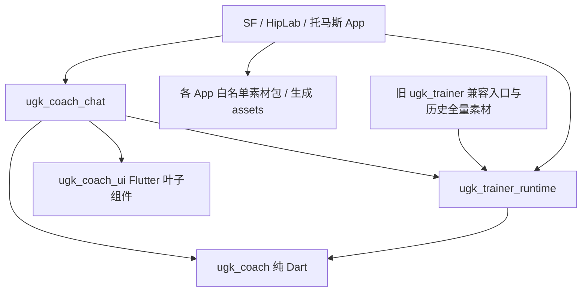

# 统一教练对话模块设计

状态：**设计稿，等待审核；尚未实现新模块或迁移 App。** 日期：2026-11-01。
分支 `codex/coach-chat-module-design`，基于已审核的新 main
`3fbd179063e9b8433cadd5387295ac07b7b93800`。本分支只改文档，推送等审，不合 main、不打 tag；各 App 暂不换 pin。

## 1. 已定目标与归属

用户已决定：SDK 仓库统一拥有训练播放、教练逻辑、卡片和**整个教练对话模块**。
以 SF `codex/coach-ui-kit` 的 `3eb2a9e88ef4d28e02f4cf306c1716d61baa7f10`
为搬迁源，保留已验收的页面、交互、数值、动画、保存/讨论/历史行为。
SF、HipLab、托马斯以后挂载同一个模块；App 保留壳、动作库页面、“我的计划”、设置与品牌，
并实现存储、网关、动作素材和导航适配。不能再在三个 App 维护三份对话页或计划语义。

以下两项已获用户确认，不再作为开放选项：

1. 拆出不含动作素材的播放 runtime；旧 `ugk_trainer` 保留兼容入口，新模块使用白名单素材包。
2. `savedRef.baseVersion` 与宿主存储版本分开；保存更新用独立 CAS 版本，不误覆盖宿主记录。

执行时长回调已在 main `3fbd179`，其接口、错误语义及双门禁直接沿用
[执行时长接入文档](fit-executed-duration.md)。本设计把它归入 `CoachAppProfile`，不另建准备/起拍估算器。

详细设计拆为四个可分别审阅的附录：

- [配置档、白名单与素材隔离](coach-chat-module-design/app-profile-isolation.md)
- [公开 API 与生命周期草案](coach-chat-module-design/public-api.md)
- [SF 文件盘点、删除估算与逐帧矩阵](coach-chat-module-design/migration-inventory.md)
- [SF 推荐错误及调用/耗时待处理项](coach-chat-module-design/agent-follow-ups.md)

文中新增类型、包、字段和错误码均为**拟议接口**；现有 API 会明确注明来源。
这次没有创建包、改源码、改 pubspec、升级 App、跑新模型或宣称完成视觉验收。

## 2. 包划分与依赖方向

建议新增 `ugk_coach_chat`，作为 Flutter 对话产品模块。为满足已确认的物理素材隔离，
同时把现有播放实现抽到 `ugk_trainer_runtime`；旧包转导出同一份实现，保留历史默认资源。



箭头表示编译依赖。`ugk_coach_ui` 继续只依赖 Flutter，不反向依赖 `ugk_coach`。
`ugk_coach` 不依赖 Flutter、UI、Chat 或 Trainer；runtime 不依赖 Chat。
**新接入链不得直接或间接依赖带全量动作素材的旧包**，否则无法通过包内素材白名单门禁。

| 位置 | 所有权 | 不承担 |
| --- | --- | --- |
| `ugk_coach` | Agent、检索/工具、受限目录与计划准入、配时、版本/focus、模型快照、伤痛规则 | 页面、Flutter 类型、App Store/全局服务 |
| `ugk_coach_ui` | 普通数据驱动的卡片、等待卡、标签、列表叶子组件、主题 token、图标/剪影插槽 | Agent 或持久化、导航决策、App 业务 |
| `ugk_trainer_runtime` | 唯一播放实现、SessionBuilder/Engine/Result、voice/media、训练 UI、路由编排、公共播放资源 | 任何动作专属目录/封面/视频/kit/命名语音全集 |
| 旧 `ugk_trainer` | 兼容 public exports、旧素材与原逻辑资源 URI 兼容层 | 第二份 Engine、第二套 Result/Recorder/原生插件 |
| `ugk_coach_chat` | 原 SF 完整对话页及其控制器/流程、视图映射、历史协议、对话侧保存/训练编排 | App 路由页面、数据库实现、网关凭据、私有目录兜底 |
| App / 白名单素材数据包 | 壳、动作库页、我的计划 CRUD、设置、品牌配置、数据与平台适配 | 自己重新实现对话、计划编辑、剂量或出卡门禁 |

runtime 拆包属于后续实施：旧 export 与新包必须指向相同 Dart 类型，原生插件只注册一次；
旧 `packages/ugk_trainer/...` 资源键与播放器默认海报/静音音轨/网页播放器需明确兼容测试。
不能只改 Dart import 就声称已经隔离资源，也不能复制一套 Trainer 给新模块。

Flutter 会自动把依赖包在 pubspec 中声明的素材随 App 打包。当前 Trainer 已声明全量
`standing/` 和目录文件，因此仅在运行时过滤 ID 或换入口不能达成物理排除。
拆 runtime 的依据见 [Flutter 包素材打包规则](https://docs.flutter.dev/ui/assets/assets-and-images#bundling-of-package-assets)。

素材包可以是 SDK 内独立数据包，也可以由同一 manifest 生成到各 App 的资产目录；推荐先用
后者适配现有打包流程。两种方案均只维护一套筛选/闭包生成规则，不新增三套对话代码。

## 3. CoachAppProfile 配置档

`CoachAppProfile` 拟归 `ugk_coach_chat` 的组装层。纯 Dart 的 scope 守卫与目录准入归
`ugk_coach`，视觉及回调留在运行时绑定中，避免反向依赖。

| 字段草案 | 类型/要求 | 语义 |
| --- | --- | --- |
| `appId`、`revision` | 非空稳定 ID、配置版本 | App/存储/缓存/记忆命名空间；托马斯沿用既有 FlareLab 身份映射 |
| `scopeManifest` | `CoachActionScopeManifest`，必填 | catalog 版本与 SHA、明确列出的 `allowedActionIds`、名单 SHA、素材 manifest SHA；无 `*`/prefix/tag 授权 |
| `allowedActionIds` | 只读 getter | 来自 scopeManifest，只有一份事实；空集合代表无可用动作，绝不代表全库 |
| `coachProfile` | 现有 `CoachProfile` | 场所、器械、能力、时长、剂量硬限与已有安全规则；在硬名单内再取交集 |
| `doseOverrides` | 按动作 ID 的语义覆盖 | 显示单位、来源字段/quantity 含义、合法范围和标准计划映射，禁止只改标签就把 reps 当保持秒 |
| `conversationPolicy` | 范围与流程策略 | 专长、范围外替代/删除/坚持规则、安全优先级、可选引导；所有操作仍受 SDK 校验 |
| `strings` | `CoachChatStrings` 草案 | 空态、建议语、输入提示、取消/失败/保存/更新/安全提示/专长说明；SF 初始值逐字取 3eb |
| `visual` | `CoachChatVisuals` 草案 | Chat token、`CoachUiStyle`、品牌图标 builder、`cutoutFor/cutoutBuilder`、背景与主题桥；初始 SF 外观完全等价 |
| `executionTiming` | **必填** `PlanExecutionTimingCallback` | 与播放器实际同一个 builder 的同步、纯函数、无 IO 测量；旧底层 API 的可选参数保持兼容 |

`outOfScopeGuidance` 放在 `conversationPolicy`，可选且默认关闭；不开启时任何说明和建议
都不提及其他 App。开启只能使用配置档提供的明确文案/目标，不让模型自行编造外部产品。

manifest、文案和策略可以做版本化配置数据；运行时的 Widget、主题对象、函数、客户端、
token/headers 不序列化。会话快照只记录配置身份/哈希，不拷贝配置、更不保存密钥。
详细字段、候选 ID 清单和来源哈希见隔离附录。

### 三 App 名单基线

| App | 明确名单来源/建议 | 设计中的约束 |
| --- | --- | --- |
| SF | 当前 SDK 交付 219 个授权动作 ID 全部显式列出 | 当前仅 211 项语义完整可用于 AI 配计划；素材 ready 不等于语义完整，8 项不猜剂量 |
| HipLab | 现 `hiplab.json` 的 45 个显式 ID 为拉伸/髋/臀候选 | 排除项如 `n-thomas-test` 不因相似标签自动回流；最终名单需产品签核 |
| 托马斯 | 从现 FlareLab 专项目录展开的 51 个 ID 为待核候选 | 逐项确认“托马斯动作”的业务范围；不是按名称含 thomas 匹配或复制 Hip 的动作 |

“SF 全量”指当前授权目录的完整冻结名单，不是未来目录自动开放。目录更新必须显式更新
名单、语义完整集合和资源闭包；HipLab/托马斯同理。配置不合法、ID 不存在或哈希不匹配
时阻止初始化并报明确配置错误，不静默放宽范围或回退全库。

### 剂量与执行回调

当前普通 `PlanItem` 只有 `reps/workSeconds`；`holdSeconds` 位于 `PlanSegment`。
HipLab 的“保持”显示与 rep_hold 每次停留秒数是不同概念，`doseOverrides` 必须明确两者：
静态保持仍映射规范 `workSeconds`，每次保持按既有 segment/rhythm/kit 含义处理。
schema 不支持的普通 item `holdSeconds` 不能伪写字段；有确切需求时先单独评审版本化映射。
显示、目录/profile 范围、PlanCodec/校验和执行 phase 的合同测试须一致。

已存在的回调签名直接复用：

```dart
typedef PlanExecutionTimingCallback =
    PlanExecutionTiming Function(TrainingPlan plan);
// result: totalSeconds、按输入 block 顺序的 blocks、containsManualCounting。
// 新模块 profile.executionTiming = playerBuilder.executionTiming。
```

新模块初始化后把同一回调传入 CoachAgent：fit、可行区间、候选增删和交付门禁全部使用它。
卡片与执行秒数都须在目标 ±10% 内，profile 更严格时从严；异常/非法结果不交付、不回退。
手动计次继续标“估算”并走同样数字门禁。替代/删除名单外动作后必须重新配时，不能以
范围限制、用户坚持或素材缺失为由交付近似计划。宿主断言回调等于播放器 timeline 的测试
是接入门禁，不能把 `PlanDuration + 常量` 作为回调。

## 4. 范围隔离与已定产品路径

名单由代码保证，而非仅写入提示词。受限目录是所有工具、提示目录、候选、卡片准入、
focus/restore、存储和开练唯一可见的数据源；原 `DrillSelector` 是并集，不能追加一个 ids
字段后继续保留全库的 apps/tags/prefix selector。新模块构造硬名单交集和 id-only core profile。

检索/目录工具只返回名单内且语义有效的动作，禁止通过详情、引用、segment、替代元数据、
历史或直接伪造 ID 绕过。非法模型草稿不进入 plans、不出卡；返回受限候选与明确重编原因，
由原 draft_plan / set_params(operation=edit) 链路重出合法计划，不新增 get_plan/edit_plan 工具。

### 范围外需求处理，按优先级执行

| 条件 | 最终产品行为 | 代码保证与告知 |
| --- | --- | --- |
| 安全/伤痛阻断 | 沿用原安全拒绝或澄清 | **最高优先级**；不因“最近替代”重开不安全训练 |
| 部分动作在名单外，存在合理替代 | 照常交付合法计划；用名单内同目标部位、同场景器械条件的最近替代 | 保留替代 provenance；说明一句“本 App 没有 X，用 Y 练同一部位”；重新过双时长与安全校验 |
| 部分动作在名单外，无合理替代 | 去掉该动作并明确告知，保留范围内可完成部分 | 不虚构相近程度，不悄悄加新器材；剩余计划须重新配时，不达标走原增删/重编链路 |
| 整个需求超范围，如 HipLab 胸背 | 不生成范围外计划；一句配置档专长说明 | 给最接近的**范围内**推荐/建议语供一键选择，不声称能满足原胸背目标；点击才接受新的目标 |
| 用户坚持名单外动作 | 如实说明没有，不编造、不假装包含 | 不把坚持当白名单扩权；不反复无提示替代；可保留范围内 CTA |
| 范围外引导 | 默认不提其他 App | 只有显式启用 `outOfScopeGuidance` 才显示配置文案；安全优先级不变 |

合理替代先按已确认部位 taxonomy、场景、器械可用条件、能力/体位和伤痛限制硬过滤，
再优先同器械/同动作类别等最近候选；阈值与映射显式可核查，不用动作名称关键词猜同部位。
找不到合理候选就走删除告知，不放宽安全规则或伪造剂量。首次点名名单外动作不自动当作
“坚持”，先走明确告知的替代/删除路径。用户明确要求“不替代/必须该动作”或后续坚持时，
记录对应用户原话，明确没有，再给可选方案，不能宣称保留了原动作。已确认剂量不能
静默换单位或放宽；不兼容时清楚说明。

“X 不在本 App”与“X 当前资料未完整”要分开；未知名称只能说当前库未找到，不能假称
知道它的器材/剂量。用户已提供的 X 可以引用，工具不能为了说明而把全库名单和媒体暴露给模型。

模块保留受校验的范围处理记录（原用户引用、替代/删除、采用的名单内 ID）；交付门禁核对
最终计划与该记录，遗漏告知时使用 profile 模板补出一句真实说明。不能只信模型自称已经
替代或已经安全。各条路径真实模型用例同时断言 ID 与告知，见第 7 节。

外部保存计划导入与模型草稿重编不同：`focusExternalPlan` 仍是不发模型请求的完整计划
原子导入。不能悄悄替换宿主记录、改变剂量后还声称导入原计划。若旧保存计划含名单外 ID，
拒绝原样准入，明确给替代/移除预览或范围内 CTA。
推荐按钮明确为“按范围内方案重新生成”：用户点击后才开启普通新计划任务，可以发模型
请求，使用既有 activePlanId 链，原保存记录不改，不伪造 savedRef 或声称非法外部导入成功。
也可提供明确“采用并另存为新计划”，创建新 externalId 成功后再走原 external focus。
本设计不新增未保存候选的 localDraft focus 域/API，也不强迫“采用”就写数据库。
原保存记录不改，保存更新仍有 CAS。具体结果与持久化失败语义见 API 附录。

物理打包同时检查 manifest 和 APK/IPA/Web asset bundle：只含名单内动作资源及必要通用
资源，命名语音/kit/封面/视频的引用闭包也须过滤，禁止转而从全库 URL 拉取名单外动作。
不是只检查 UI 不显示。每个 App 各有一条自动化端到端计划集合断言，包含所有 block、
segment、编辑/focus/restore 与开练入口，详见隔离附录。

## 5. 模块接口与宿主边界

### 模块自有

对话页和星空/空态、输入栏/键盘/功能面板、建议语、等待与进度、取消/失败/重试、
问答/表单、文字/推荐/计划出卡、计划展开与保存状态、当前讨论标签与清除、滚动与回场、
历史/快照与旧数据转换协议、新对话、“发到对话”、训练完成返回气泡均在模块。
详细计划视图从 SF `PlanPage` 抽到共享 `CoachChatPlanDetailsPage`；App 的“我的计划”
也可使用这个视图，保留自己的列表/编辑入口与数据库适配，不保留一份独立聊天详情页。

`CoachChatController` 是 Flutter 可监听外观控制器，内部只有一个既有
`CoachConversationController` 和一个 Agent。核心 plans、versions、focus、pendingQuestion
以 `ugk_coach` 为真源；显示动画、本地安全告知和 UI 消息是派生状态，不再复制一个计划账本。

### 宿主提供

| 接口草案 | 宿主职责 |
| --- | --- |
| `CoachAppProfile` + scope/cached catalog | 明确配置、已加载的受限数据与同 builder 时长回调 |
| `CoachPlanStorageAdapter` | 读取保存计划、创建/更新/另存；支持 storageRevision CAS，保存成功后返回实际记录 |
| `CoachChatHistoryStore` | 持久化模块 snapshot、读取原历史/训练摘要、更新“上次计划/使用时间”；不重复保存训练结果 |
| preferences/safety/memory adapters | 已有设置、安全确认、记忆存储的 App 命名空间与用户控制 |
| `CoachChatHostActions` | typed 导航到动作库/我的计划/设置、打开动作、开始训练；无 UI 字符串命令执行任意宿主行为 |
| gateway binding | `LlmConfig` 与 `AuthProvider` / 可释放 client factory；凭据与设备身份仍由宿主管理 |
| 图标/主题/媒体插槽 | 使用模块既有布局提供品牌 CustomPainter、剪影与已预热海报，不接管卡片尺寸和时序 |

公开入口草案为 `CoachChatPage`、`CoachChatController`、`CoachChatState`、`CoachAppProfile`、
存储适配接口、typed actions、`CoachChatSnapshot`、`CoachChatPlanDetailsPage`。
控制器提供 start/send/answer/cancel/newConversation/sendPlanToConversation/clearPlanFocus/
export/restore/flush/close；完整参数和返回结果见 [API 附录](coach-chat-module-design/public-api.md)。
这些入口不把原始 Agent 交回 App 让其并发调用，也不把所有页面 widget 都公开成可任意重排的插槽。

保存 adapter 是唯一写入方，`onSaved` 只是成功通知。`savedRef.baseVersion` 是导入时的
**SDK 计划版本**，宿主另返回不透明 `storageRevision`，更新用 `expectedStorageRevision`。
冲突提示更新/另存，不默认覆盖；记录被删也不悄悄复活原 externalId。旧卡仍保留自己的版本与出处。

开始训练回调复用现有 `TrainingPlan`、同一 runtime 的 `SessionResult`/receipt 与路由控制。
Trainer 仍负责 engine/recorder/save/completeReceipt；Chat 只按 sessionId 幂等更新返回气泡。
原 startGate/beforeExitPop/onExitStarted、海报准备、视口冻结和入口互斥不重做；
视频播放、倒计时、语音、hold 不得在路由/准备 gate 打开前启动。

快照 envelope 在现有 core snapshot 外增加 app/profile/catalog/名单身份，独立 schema 版本。
恢复前先重新验证范围和计划；不同 App/名单收窄不能借历史恢复越权。读取旧 SF 数据是
一次性、可回滚、幂等迁移：不清原数据，不把显示旧卡当有效模型上下文；取消/新对话/销毁
采用 generation 使迟到响应失效，flush 与保存顺序保持可测。

旧卡的存储基准不能只按 externalId 保留“最新 revision”：每次导入/来源快照有不可变
`saveBindingId`，卡片绑定原 externalId、SDK baseVersion、源内容摘要与当时 storageRevision。
同 externalId 重选后，旧卡仍持旧 token，不能自动拿到新 token 覆盖新内容；快照保留全部
来源绑定。库内计划只看详情另有无会话副作用的准入入口，不为浏览详情改变 focus 或发模型。
网关工厂通过显式 `CoachGatewayClientLease`/release 合同释放客户端，不能假定 `LlmClient` 接口自带 close。

## 6. SF 搬迁清单与工作量

已对 immutable SF `3eb2a9e` 逐项核对 54 个源文件和 27 个相关测试文件。
源树中的旧 `coach_task_bubble.dart`、delivery/focus 独立实现已经迁到 SDK，不能重复计算。

| 分组 | 处理方式 | 精确源行数/估算 |
| --- | --- | ---: |
| 原对话核心 + UI 候选（16 文件） | 搬通用逻辑/页面，移除 AppServices 和 App 类型耦合 | 5344 行 |
| 宿主重写/保留配置、存储、导航适配预算 | 实施后按实际 diff 验证，不是已删除 | 650–1050 行 |
| **预计运行源净删除** | 5344 减宿主适配预算 | **4294–4694 行** |
| “我的计划”三文件 | 留宿主，不计删除 | 1393 行 |
| 共用 PlanPage、主题/媒体/冻结等 | 部分抽出/共享，保守不计上述净删 | 逐项见附录 |
| 相关测试候选 | 迁移模块测试，宿主保留集成断言；单独计量 | 7931 行，预计净减 5731–6731 行 |
| 生成代码 | 原源树没有此类迁移目标 | 0 行 |

测试行数不是要削减测试覆盖的目标。详细逐文件目标包、保留原因、行数计算命令、
特效/主题/诊断边界见 [搬迁附录](coach-chat-module-design/migration-inventory.md)。
现有“My plans”CRUD、设置、品牌、动作库与自定义计划编辑均留宿主，引用 SDK 共享视图。

## 7. 验收方案

### SF 先验收，再接 HipLab、托马斯

实施前从 immutable SF `3eb2a9e` 采集原页浅/深色逐帧基准并封存，记录源 SHA、字体/图标/
剪影/媒体字节、DPR/viewport、平台/renderer、时钟、星场 seed、键盘和减少动效设置。
原 SF **没有整页 golden**，SDK 既有 16 张组件图不能替代整页证据。本设计不生成或批准新图。

迁移前后同一固定消息/问答/计划/媒体脚本、同一环境、同一每帧时间点做 exact pixel compare，
浅/深所有帧 **0 像素差**，没有百分比容差或“看起来一致”替代，不更新新实现的输出为旧基线。
覆盖空态、输入/IME/菜单、取消/错误、等待至推荐/计划的全部中间帧、卡片三态、焦点标签、
保存更新/另存、历史恢复、新对话、外部计划发到对话、计划详情、训练入场/提前结束/失败重试/
自然完成返回及减少动效。具体 60/120Hz 与事件边界 ±1ms 矩阵见搬迁附录。

真实模型独立于逐帧比对：模型内容不确定，不能靠重抽让新旧截图碰巧相同。
迁移前旧 SF 页与迁移后模块使用同一已审核执行回调、实际 builder 和 profile；
5 分钟五次独立会话、10/20 分钟各一次，卡片/执行双门禁、无非法 ID、不重抽/截断/豁免，
记录最后轮及总调用/耗时/重编原因/估算标志，保留中间失败。既有 main 3fbd 记录是
[上一轮回调验收](reports/fit-executed-duration-20261101/README.md)，不冒称已经完成模块迁移验收。

三 App 迁入同一套实现后各有独立 `plan_ids_are_subset_of_app_allowlist` 自动断言，并覆盖
检索/get_action/目录读取、恶意 draft、编辑、snapshot/focus、保存和开始训练，无名单外 ID。
验证四个逻辑/界面包及 runtime、旧入口兼容、宿主集成测试和 fatal-info analyze；构建产物
还要检查 AssetManifest 与包内完整引用闭包、旧资源 URI、唯一插件注册及非动作公共资源。

### 范围外真实模型用例，每条至少一例

以下是未来实施验收，不是本次 docs 已运行的结果。使用签核的各 App ID manifest 和固定
场景器械；每次新会话，保留公开工具回执和最终 state，不能用 plan 为 null 的空集合断言
冒充“计划合格”。

| 用例 | 输入类型 | 必须断言 |
| --- | --- | --- |
| R1 部分可替代 | 合法目标中点名一个本 App 没有、但同部位有合理替代的动作 | 非空合法计划；各 block 的 item.exerciseId 与 segment.exerciseId 在名单；包含 X→Y 的真实告知；目标/场景器械/安全与双时长合格 |
| R2 部分无替代 | 其余需求在范围内，一个动作无合理替代 | 若可形成合格计划则非空计划+删除告知+双门禁；不得编造近似替代；不能形成时走明确范围建议，不交近似计划 |
| R3 全需求超范围 | HipLab 要胸背计划 | 无范围外计划；一句配置专长+范围内 CTA，推荐动作自身也全在名单；不得谎称已完成胸背目标 |
| R4 用户坚持 | 在 R1/R3 后明确坚持原名单外动作 | 诚实“本 App 没有”，没有伪 ID/假包含，没有无说明自动换掉用户坚持的动作；可给范围内选择 |
| R5 引导默认关闭/显式开启 | 同样超范围请求，两个 profile 配置 | 关闭不提其他 App；开启仅使用配置文案/目标；两者均无越权计划并有告知 |
| R6 安全优先 | 范围外需求同时有原规则阻断的伤痛/风险条件 | 沿用安全拒绝/澄清，不交替代训练绕过阻断；有安全告知，名单约束不失效 |

对“不给计划”的路径明确断言 `plan == null`、告知语义和可选择建议；对交付路径明确断言
非空完整计划、所有 ID、动作替代关系与实际时间线。告知以受限目录真实名称与处理记录
验证，不能只测任意非空字符串或模型自称。建议覆盖三个 App，至少 HipLab 六类均有实测。

## 8. 两项明确待处理

1. **SF 推荐轮既有 unseen_actions**：five-3 第二轮三次 show_actions 被拦后超重交预算。
   根因是仍留在已完成的 plan task，show 路径临时切 recommend 并清掉 seen，而 search/check
   使用旧 task，来源作用域不一致。修法应让任务切换、搜索和输出使用同一有效 scope/epoch，
   不放宽 seen 校验，不把模型给出的 ID 直接授信；失败不污染第 1 轮计划与第 3 轮编辑基线。
2. **SF 最终轮最多 9 调用、最长约 29 秒**：不是同一条样本（9 次为 23.122 秒；最长为
   8 次 / 29.001 秒）。按每次公开工具/回执区分披露、搜索、无效阶段、replace_too_similar、
   重复 draft 和 show 自动 refit，不能把所有轮次算作执行配时开销。降低方案与验证预算见
   [调用分析附录](coach-chat-module-design/agent-follow-ups.md)。不改搜索顺序、剂量范围或安全/双时长门禁。

降低建议按顺序为：先修有效 task/scope；固定 start→set→search→draft 的 typed 批次，
继续执行同一参数门禁；复用已可见技能和自动 check/review，合并合规检索，明确原主体
及合法替换差异候选。约束已知的正常路径目标为 3–4 次 HTTP，一次真实修复目标不超过
6 次；这是待复验预算，不替代 maxSteps/maxResubmits，也不允许提前交付或补抽。
现有各 HTTP 耗时合计与最终轮总耗时的差额只有未分项综合开销，不能推断每次本地 fit
成本或承诺固定省几秒。先补最小 span，再判断本地测量是否需要优化。

这两项本次只写根因、推荐修法和验收；不在设计分支混入运行代码。先独立逻辑补丁验收，
再让原页/新模块共用同一内核做 A/B，不用已知失败伪造“所有真实轮次成功”。

## 9. 风险与推荐

| 项目 | 当前事实/风险 | 推荐与关闭条件 |
| --- | --- | --- |
| runtime 拆包兼容 | 用户已批准，尚未实施；旧包声明全素材 | 一份 runtime 实现、旧入口转导出；资源 URI/插件/类型身份/旧调用全量测试通过后接新 Chat |
| 名单最终内容 | SF219/211已核，Hip45/Thomas51是来源候选 | 产品逐 ID 签核并冻结 hash；新增目录不自动授权，不能按 tag/prefix 扩权 |
| 零像素基线 | 原 SF 没有整页 golden，动画含时钟/星场/媒体 | 原源先采集封存；缺字体/素材/renderer条件时不得宣称0差，先补齐条件 |
| 新隔离拒绝与旧行为冲突 | 旧错误路径可能先显示不合法保存卡 | 优先已定安全/范围处理；把具体旧脚本冲突单独交审，不能静默放宽隔离或自动更新基线 |
| 剂量单位 | 静态保持与rep_hold不同，普通item无holdSeconds | 明确normalizer与schema，未知映射报错；profile覆盖需catalog/执行合同测试 |
| 状态重复 | SF曾维护App显示状态与core状态 | core唯一计划事实；搬UI呈现，不另造编辑/配时器，late-reply/cancel/restore回归 |
| 保存覆盖/删除竞态 | SDK baseVersion不是数据库版本；focus后落盘也可能失败 | 独立opaque storageRevision CAS；显式冲突/另存；已接受focus与持久化失败分开报告 |
| 训练返回重复 | Chat/路由/Trainer均有异步回调 | Trainer唯一保存receipt；Chat按sessionId幂等显示，gate前退出不生成训练结果 |
| 网关与数据边界 | 三App可能共享SDK但不能共享会话身份 | appId/profile命名空间；宿主管理AuthProvider和数据，snapshot/日志无token或私有推理 |
| 推荐轮错误 | 既有scope切换会导致合法搜索后仍unseen | 先完成独立修补及跨任务回归，再评估真实调用收益，不靠扩大目录/seen |
| 多调用/耗时 | 重编与工具周转原因混杂，不能从总耗时推断本地fit成本 | 逐次公开trace归因；先消除确定冗余，再量测客户端/模型耗时，成本预算为目标非已实现 |
| 字段膨胀/自定义整页 | 容易把模块退化成多个App重新拼页面 | 公开配置、数据和边界动作；组件布局/动画SDK独占，新增字段按真实差异评审 |

## 10. 实施顺序与设计验收

本次 D0：提交本设计、来源清单、API草案、范围策略、回归与成本分析，确认 diff 只有文档。
后续建议按以下可独立审核的批次实施：

1. runtime 拆分与白名单资源闭包/构建检查，保持旧 `ugk_trainer` 默认兼容；签核三 App manifest。
2. 统一 scope/范围处理的 core 守卫，独立处理 SF 推荐错误与工具冗余；保留原配时与安全约束。
3. 从 SF3eb 封存原页逐帧基线，再机械抽入 Chat 模块；用存储/主题/媒体/路由 adapter 消除 App 依赖。
4. SF 仅换模块挂载及适配，旧数据迁移不清理；逐帧0差、功能、真实模型与资产门禁全部通过。
5. HipLab、托马斯分别接入同包，配置差异不允许fork页面；各自白名单/单位/安全/真实模型/素材验收。

发布前所有App按审核通过的完整 SDK commit 同步解析依赖，不能用 path、分支或缓存补丁
替代正式 pin。本次各 App pin 未动；后续每次升级仍需各 App 自己验收，不把 SDK 测试冒充真机证据。

### 参考实现取舍

迁移以已验收 SF 为唯一视觉与行为来源，不从零重绘。对新模块边界还查阅了维护中的
[Flyer Chat](https://github.com/flyerhq/flutter_chat_ui)，其 core/UI 分包和 controller/builder
注入可供设计参考，许可证为 [Apache-2.0](https://github.com/flyerhq/flutter_chat_ui/blob/main/LICENSE)。
它会引入另一套消息/控制器/缓存依赖，且其 [2.3.1 发布说明](https://github.com/flyerhq/flutter_chat_ui/releases/tag/v2.3.1)
记录过依赖变动导致 controller 接口变化，因此本设计不新增该运行依赖或复制第三方实现；
复用现有 UGK core 与 SF 布局更符合零差迁移的约束。这是本项目的取舍，不是对该项目质量的评价。

依赖注入、界面/数据分层和 adapter 仓储边界参考
[Flutter 架构建议](https://docs.flutter.dev/app-architecture/recommendations)，使用现有
ChangeNotifier/listener 和存储接口即可，不为抽取本身引入新状态管理或生成代码体系。
