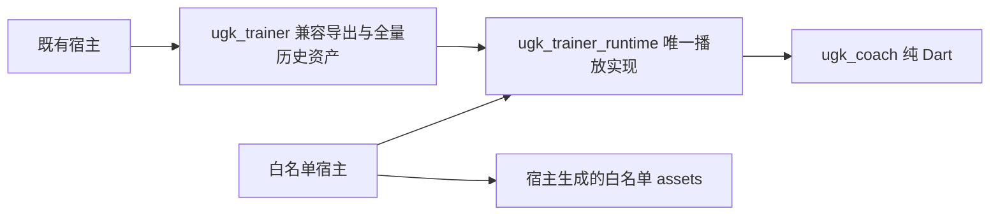

# 第 1 批：训练 runtime 拆分与素材闭包

分支 `codex/trainer-runtime-split`，基于设计稿已合入后的 main
`abae72d138d7785ab6c25bfd9eed4f6ac77aa7ef`。只实施第 1 批，完成后推送分支等审；
不合 main、不打 tag、不改各 App 或 pin。

获批设计的两项决定保持：播放 runtime 与动作素材分离，宿主 `storageRevision` 与
`savedRef.baseVersion` 分离。范围外处理矩阵不变。本批没有创建 `ugk_coach_chat`，
没有修改 Coach 出计划、配时、安全、检索或推荐逻辑。

SF 名单仍为 **219 授权 / 211 可规划**。HipLab 45、托马斯 51 **仍是待用户签核的候选**；
没有生成它们的正式 manifest。构建用单动作 manifest 只属于 SDK 门禁样例。

## 包与实现所有权



旧 Trainer 的完整 `lib` 实现和 Android 插件移动到新包。旧 `engine.dart`、主入口和
可独立导入的 `src/*.dart` 只做转导出；原 part 文件随唯一宿主文件移动，不保留另一份实现。
`SessionBuilder`、Engine、Result/Recorder、voice/media、训练 UI、路由、平台 channel
均共用同一份类型和静态状态。Android 只由 runtime 注册
`com.ugk.trainer.UgkTrainerPlugin`，旧包没有 plugin 声明。

旧包继续声明历史全量目录和 standing 图，旧物理资源键仍然存在。
runtime 只声明静音音轨、两个公共网页播放器和 alpha shader；没有任何动作专属目录、
封面、视频、kit、命名语音。少量公共资源原字节同时保留在旧包，保证旧 URI 可加载，
不等于两份代码或两次插件注册。

内部兄弟包依赖使用同一 Git 树的相对路径，宿主以完整 Git SHA 固定 SDK。没有新增
可变 tag/分支依赖，也没有写入任何 App 的本地 path pin。

## 兼容与新增入口

既有 Trainer 参数、默认行为和公开常量值不变。新宿主使用：

```dart
import 'package:ugk_trainer_runtime/ugk_trainer_runtime.dart';
// 纯 Dart：package:ugk_trainer_runtime/engine.dart
```

新增 `TrainerRuntimeAssets` 暴露公共资源名和
`Future<String> resolveAsset(String key, {AssetBundle? bundle})`。
在旧包依赖存在时优先使用实际旧键；runtime-only 时内部加载已知公共资源的新键。
仅处理 silence、shader、media_player、pose_hub_player 别名；动作路径保持原样，缺失
仍报错。`PoseHubActionLibrary` 与默认 standing 海报的旧默认路径保持兼容，runtime-only
宿主必须显式传自己的目录、海报和媒体数据，不会自动拉取全库。

真正发生代码改动的迁移文件只涉及公共资源加载与路由：keep-alive 静音音轨、shader、
原生/网页播放器的资源路径。Engine、SessionBuilder、Result、训练 UI/路由、语音编排与
Android 实现保持原内容；未更改训练页样式、进出场、计时或任何时长规则。

## 一个 manifest 的闭包工具

入口、完整字段和宿主操作见[白名单生成工具](trainer-assets-closure.md)：

```powershell
dart run tool/trainer_asset_closure.dart --manifest approved-scope.json --out new-output --asset-prefix assets/trainer
```

生成过滤后的交付目录、语义目录、被选动作素材、可选 kit/命名语音引用闭包，以及
`asset-closure.json` 逐文件 SHA/bytes/owner 收据和 `pubspec-assets.yaml` 明确文件清单。
输入只读，输出目录必须不存在或为空，不覆盖已有内容。工具离线执行；缺文件、hash/bytes
不符、未知/重复/空 ID、越界路径均配置失败，不下载、不默认为全库、不丢引用后声称成功。

历史 semantic 的跨 App 素材绑定由显式 `pose-hub-delivery@1` adapter 投影为当前交付素材。
是否启用 voice/kit 必须显式声明；原语义字段的移除与投影写入 proof。
启用 voice/kit 时严格追完所引用的文件；静音/no-kit 样例不能被描述成已经验证生产命名语音包。
生成工具不开放任意共享文件复制口，避免把全库目录、名单外 kit/命名语音夹带进闭包。

## 验证记录

以下结果以本分支最终门禁日志为准。原有测试文件、golden PNG 与比较器均不修改；
未跳过测试、更新基线或放宽阈值。

| 包 / 检查 | 结果 |
| --- | --- |
| `ugk_coach` 全量 | 1472 / 1472（原 1432 + 闭包 40） |
| `ugk_coach_ui` 全量 | 178 / 178 |
| 旧 `ugk_trainer` 全量 | 578 / 578（原 564 + 兼容 14） |
| 新 `ugk_trainer_runtime` 全量 | 15 / 15 |
| 四包 `dart analyze --fatal-infos` | 全部 0 问题；同源码 SHA 的干净工作树，分析配置与提交原字节相同 |
| 默认 golden（浅/深共 16 张） | 全部通过，0 像素差；包含在 UI 178 项中 |
| 公共网页播放器协议 | 8 / 8 + 11 / 11 |
| 实物 APK / AssetManifest 审计 | R3 双构建与实物检查全部通过；Python 11 / 11（解码器 8 + 归档 3）；宿主 probe 各 1 / 1 |
| 完整 Git SHA 兄弟包解析 | 无 overrides，三个包都解析为同一完整 Git SHA；离线 enforce-lockfile 与 Engine/Builder/Result 类型同一检查通过 |

首次同时运行 Flutter 全量时，UI 的 Dart VM 在 optimizing JIT 的 AllocateRegisters 阶段
原生崩溃；Trainer 进程随后无子进程且不再推进。这轮没有计为通过，原始日志保留。
收尾终止的进程严格限定本工作树的测试进程，Flutter 完整测试串行重跑通过。
随后根包全量与多包分析并行，日志明确报告 `Out of memory`，PowerShell 也报内存不足；
根包在 `plan_adjustment_retry_test` 的 JSON 编码处内存分配失败，并非断言期望被改变。
根包和相应分析均未计为通过。最终全部 Dart 门禁与构建分开执行，不修改断言、超时或 golden。
保留所有首次失败日志，不修改全局工具链或终止其他项目进程。

带有全部构建存档的开发工作树曾另报 32 条分析告警：依赖凭证原样保存为
`pubspec.yaml`，旁边没有该项目的 assets，被分析器当成新项目；R1 失败样例也保留着
当时缺少 flutter_lints 的配置。它们不是本分支源码包的诊断，仍如实保留日志。
工具的新凭证改用原字节 `.snapshot`，不再伪装成活项目。最终分析在同一源码 SHA 的
干净完整 checkout 执行全部四包，不增 exclude、不关闭规则、不清理旧存档代替通过。

日志位于 SDK 工作树的 `build/runtime-split/`。新增兼容测试覆盖新旧类型/静态平台同一、
公共文件旧键与原始字节、默认 standing 海报、网页资源、shader 和唯一插件。
闭包工具测试覆盖 voice/kit 引用、名单/完整性/路径/缺件错误与不覆盖已有输出。

验证源码提交为 `3e24002a55da19a16a08d759b7f58b83f792f6bc`，分析工作树为
SDK 内独立的 `.worktrees/trainer-runtime-split-verify`，不带开发构建存档。沿用全量测试
的四份锁文件，用 `--offline --enforce-lockfile` 还原依赖；Flutter 自动写入的分析
排除项逐项核对后恢复提交原字节，再执行各包完整 `dart analyze --fatal-infos`。
四条命令均退出 0，`git status --short` 与 `git diff --exit-code` 均为空/0。
收尾提交只更新本 Markdown 验证记录，不改变上述源码或构建输入。

Git 解析另在 `build/runtime-split/git-pin-3e24002/` 新建探针，仅直接依赖旧 Trainer，
以本地 `file:` Git 传输固定上述完整 SHA，未用 `dependency_overrides` 或 workspace
path 覆盖。锁文件中 Coach、Trainer、runtime 的 `source` 都是 `git`，`resolved-ref`
全等；实际 package root 均来自同一 Pub Git checkout，HEAD 也逐一核对为该 SHA。
`flutter pub get --offline --enforce-lockfile` 及纯 Dart engine 类型同一检查均退出 0。
完整收据为该目录的 `receipt.json`。它验证 Git 包内兄弟路径解析，不代表已替 App
修改依赖、走远端生产发布或完成 App 验收。

## 实物构建与体积

最小宿主、命令、真实输入来源、APK/manifest/ZIP/插件审计收据及结果见
[构建门禁](runtime-split-build-gate.md)。宿主只存在 SDK 的 ignored build 目录，
没有写 SF、HipLab、托马斯仓库，没有安装或操作设备。

同一个宿主和同一份小名单分别依赖 runtime 与旧包，使用相同工具链构建 Android arm64
release；解码 APK 的真实 `AssetManifest.bin` 并同时检查全部 ZIP 文件。不能用 pubspec、
源码文本或被裁掉的假旧包代替实物对照。

| arm64 release | runtime-only | 旧包兼容入口 |
| --- | ---: | ---: |
| APK 字节 | 17176180 | 23805071 |
| Flutter assets 未压缩字节 | 1394114 | 12721482 |
| Flutter asset 文件数 | 22 | 253 |
| Trainer 插件注册 / 服务声明 | 1 / 1 | 1 / 1 |

APK 减少 **6628891 字节**，Flutter assets 减少 **11327368 字节**。runtime-only 的
白名单 6 文件均与原 receipt 的 SHA/bytes 相等，名单外动作素材和目录引用为 0；
旧包对照包含 219 张 standing 与 2 个索引，全部 230 个历史非 shader 资源逐字节保持。

## 改动清单与边界

相对 `abae72d`，按 Git 默认 rename 识别口径统计：**155 文件，+20434 / -15949 行**。
新增行大量来自把原路径实现移到 runtime，再给旧路径保留转导出，并非重写训练逻辑。

| 路径组 | 文件数 | 新增行 | 删除行 |
| --- | ---: | ---: | ---: |
| 根 `README.md` | 1 | 4 | 0 |
| `docs/` 三份本批文档 | 3 | 513 | 0 |
| `examples/trainer_runtime_minimal/` | 3 | 170 | 0 |
| `packages/ugk_trainer/` 兼容层、锁文件和新增测试 | 63 | 512 | 15949 |
| `packages/ugk_trainer_runtime/` 新增路径 | 72 | 16849 | 0 |
| Android 6 文件、原 part、来源说明的同字节重命名 | 8 | 0 | 0 |
| `test/trainer_asset_closure_test.dart` | 1 | 648 | 0 |
| `tool/` 两工具及实现/审计测试 | 4 | 1738 | 0 |

另有 1 个复制的二进制静音音轨，不计入行数。原 lib/Android/shader 的 68 个文件中，
61 个在新位置逐字节相同；差异只有上述 6 个公共资源 loader/router 与 barrel alias。
旧 59 个可导入 Dart 库全部转导出对应新实现，原 230 个资源及 shader 字节均未更改。
逐文件名称和行数可由 `git diff --numstat abae72d HEAD` 复核。重点入口：

- `packages/ugk_trainer_runtime/`：唯一播放实现、Android 插件与公共资源。
- `packages/ugk_trainer/`：兼容转导出、依赖及新增兼容测试；历史素材原样保留。
- `tool/trainer_asset_closure.dart`、`tool/src/trainer_assets/`：唯一离线素材生成工具。
- `tool/verify_trainer_runtime_bundle.py`、`examples/trainer_runtime_minimal/`：构建和实物审计。
- 新增测试与本批文档；Coach/UI 生产源码不变。

本批证明 SDK 包拆分、资源兼容、白名单物理排除和最小 Android 宿主可构建，不代表
真实 App 已迁移、iOS/设备播放/性能验收或 SF 整页逐帧验收。SF 整页基线由 SF Agent 在
第 3 批采集封存，SDK 届时只提供脚本与环境清单。本批审核前不开始第 2 批 scope 守卫、
`unseen_actions` 修复或 HTTP 调用降低工作。
