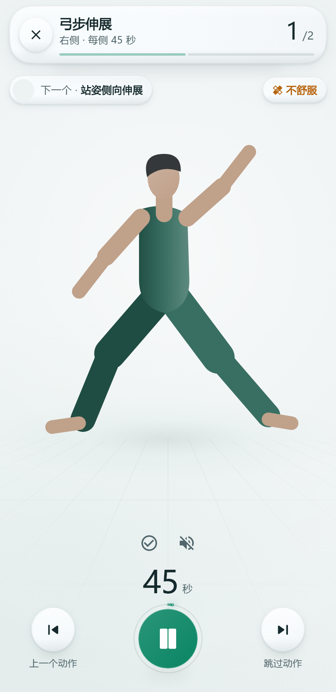
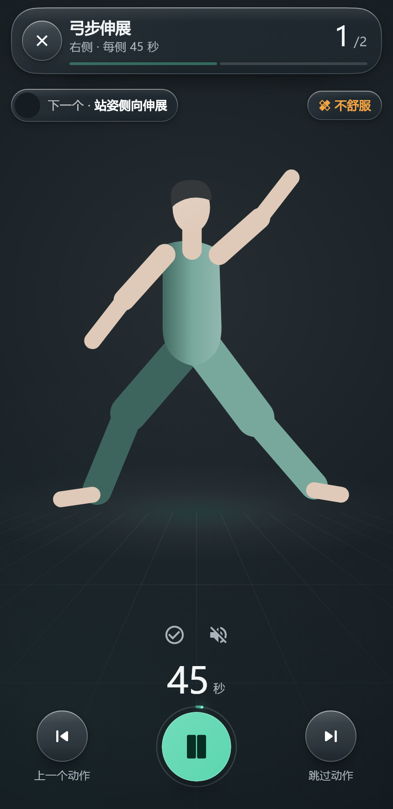
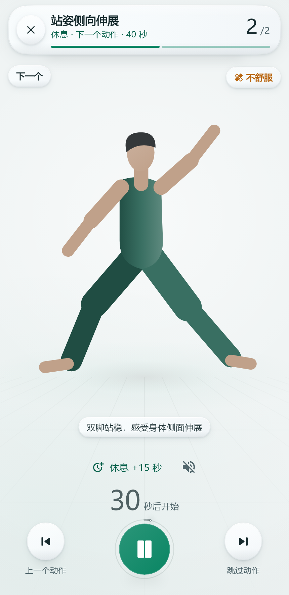
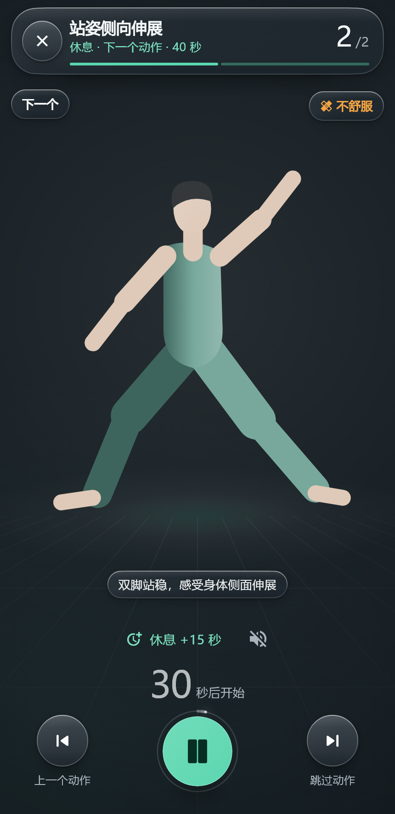
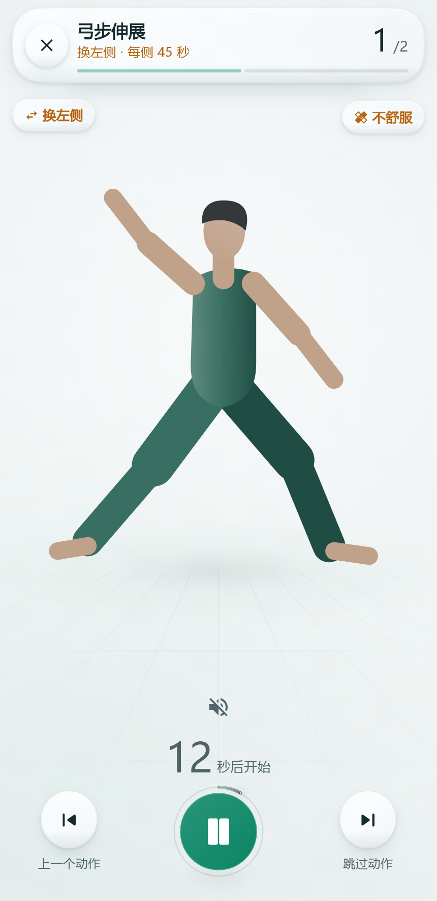
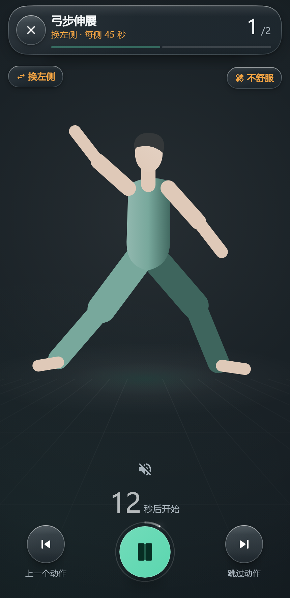
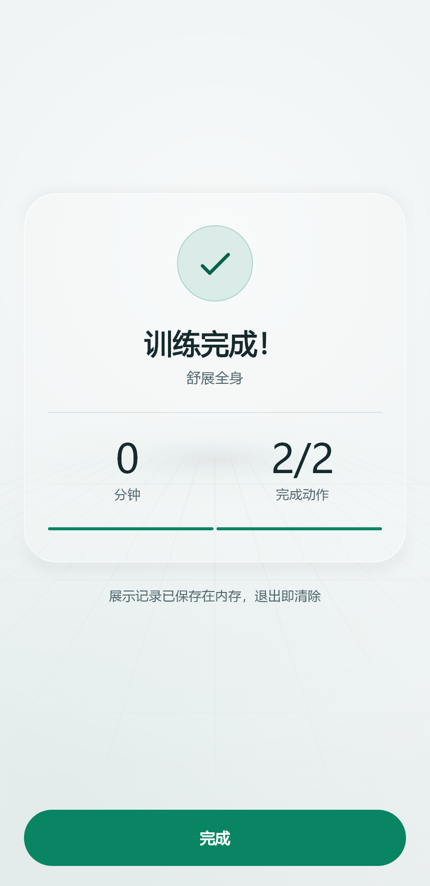
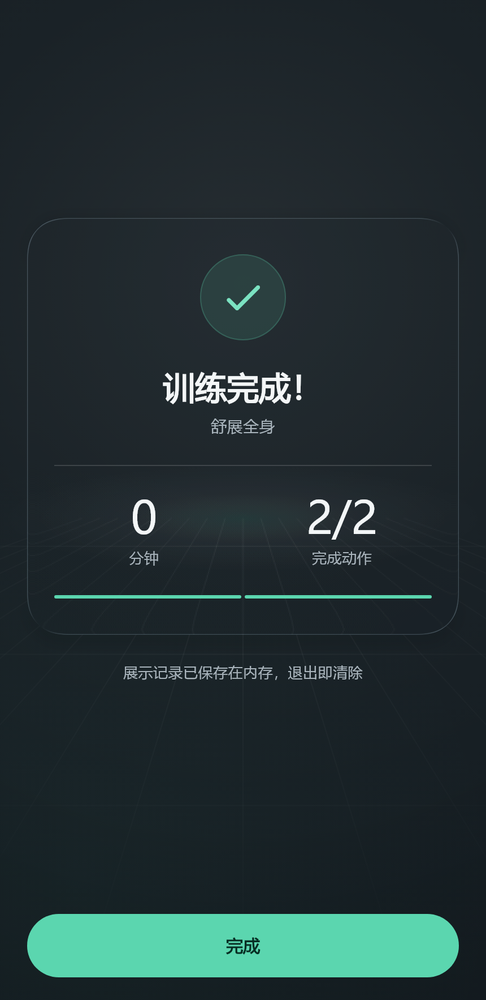

# 训练播放页视觉评审候选

基线：`ugk_trainer-v0.2.9` → `953be22414f23128af879dc62686db200db34265`。候选在 `codex/trainer-liquid-glass`，本记录与代码一同提交；未合 main、未发 tag。

[打开四状态浅深前后对照图库](visual-review.html) · [设计、依赖与性能边界](liquid-glass-design.md) · [展示页运行说明](../example/README.md)

## 运行

从候选分支工作树执行：

```powershell
cd packages/ugk_trainer/example
flutter pub get
flutter run -d <设备ID>
```

独立应用 ID：`com.ugk.trainer.showcase`。通过顶部工具栏选择训练中、休息、换侧、结果，切换浅色／深色／跟随系统。使用真实 `TrainerPlayer` 和引擎、假数据、原创透明矢量人物；结果由真实短训练生成，保存只在内存。没有真实媒体下载、业务账号或设备数据操作。

## 当轮验证

- 包静态分析、示例静态分析通过。
- SDK 完整测试 249 项通过；最后一轮纯视觉微调（结果背景／阴影、休息按钮文字、控制间距）后，相关 17 项再次通过。
- 展示页 4 项测试通过：四状态与结果回调、主题切换保留暂停、跟随系统与显式主题优先级、成对截图。
- 重绘探针证明视频、暂停呼吸、进度环各自更新时，倒计时与 prev/skip 等其他观察区域不重绘。原有光环径向渐变及三个 `RepaintBoundary` 保留。
- 原有失败 `stage_r9_test: player: Tab reaches pause, Space pauses and resumes` 在基线复现；仅修正过期的焦点标记 key，行为断言保留，候选通过。
- 浏览器实际运行观察到训练及结果页面、结果浅深切换保留统计。仅作为 Web 渲染与交互检查，不替代原生平台验证。
- Android 调试 APK 构建通过（最终增量构建 22.1 秒），未安装到用户设备。路径：`example/build/app/outputs/flutter-apk/app-debug.apk`；165022800 bytes；SHA-256：`F82E0819C4384DAC2BED2AE55B6EFEA3C4825443D8D733966852561970E37C8A`。源码为包含本记录的候选提交；调试包不是发布包。

## 截图范围

下列 16 张图片均由 Flutter test renderer 生成，来源、源文件摘要及图片 SHA-256 见 [capture-manifest.json](visuals/capture-manifest.json)。同一 430×932 逻辑视口，排除工具栏后为 430×883，2× PNG，1000ms，加载本机中文与 Material Icons 字体，启用真实软阴影。字体未复制或分发。

它们支持构图、文字、浅深关系的审阅，不能证明 Android／iOS GPU 折射或视频性能。结果面背景线条可透过镜片；连续边缘光学、真机原生媒体、低端机帧率仍待验。用户视觉满意度尚未确认。

### 训练中

| 浅色候选 | 深色候选 |
| --- | --- |
|  |  |

### 休息

| 浅色候选 | 深色候选 |
| --- | --- |
|  |  |

### 换侧

| 浅色候选 | 深色候选 |
| --- | --- |
|  |  |

### 结果

| 浅色候选 | 深色候选 |
| --- | --- |
|  |  |

## 未执行

Android 真机安装／视觉／原生透明视频合成／profile 帧率、iOS 构建及运行均未执行。旧 tag 的设备性能数字不是本轮证据。后台、来电与语音未做设备验证；本轮没有修改对应生产逻辑。
